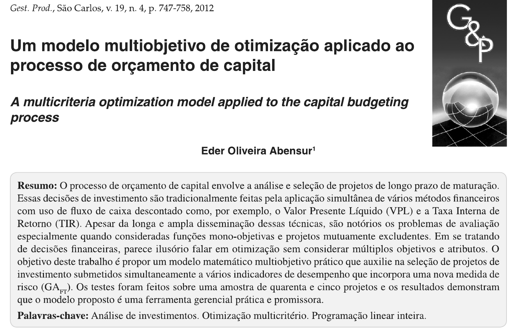
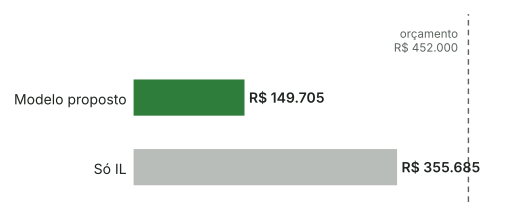

## O artigo

:::: {.columns}
::: {.column width="56%"}
{.print-artigo}
:::

::: {.column width="3%"}
:::

::: {.column width="41%"}
::: {.ficha}
[Título]{.rotulo}
Um modelo multiobjetivo de otimização aplicado ao processo de orçamento de capital

[Autor]{.rotulo}
Eder Oliveira Abensur (UFABC)

[Periódico]{.rotulo}
*Gestão & Produção*, São Carlos, v. 19, n. 4, p. 747-758, 2012

[DOI]{.rotulo}
[10.1590/S0104-530X2012000400007](https://doi.org/10.1590/S0104-530X2012000400007)

[Tramitação]{.rotulo}
Recebido em 10/7/2011, aceito em 15/2/2012
:::
:::
::::

[Fonte: primeira página do artigo; DOI conferido no Crossref.]{.fonte}

::: {.notes}
Antes de entrar no conteúdo, a ficha do artigo. É um trabalho de autor único, o professor Eder Abensur, da UFABC, publicado em 2012 na revista Gestão & Produção, editada em São Carlos. O artigo tem 12 páginas e as palavras-chave já dizem o caminho: análise de investimentos, otimização multicritério e programação linear inteira.
:::

## Por que isso importa

::: {.kpis}
::: {.kpi}
[US\$ 6,9 bi]{.num}
[orçamento de 21 projetos selecionados pela Vale em 2010]{.rot}
:::
::: {.kpi}
[≈ 40%]{.num}
[do lucro líquido da empresa no mesmo ano]{.rot}
:::
:::

 

[Escolher projetos é decidir o futuro da empresa com recursos que não dão para tudo.]{.frase}

[Dados: Abensur (2012), seção 1, citando Companhia Vale do Rio Doce (2011a; 2011b). Frase de destaque: síntese do apresentador.]{.fonte}

::: {.notes}
Para começar, um número que o próprio autor usa para mostrar o tamanho do tema. Em 2010 a Vale selecionou 21 projetos, somando 6,9 bilhões de dólares, quase 40% do lucro líquido do ano. Isso é orçamento de capital: decidir em quais projetos de longo prazo a empresa coloca dinheiro que é limitado. Um erro aqui fica com a empresa por anos. É esse o problema que o artigo ataca.
:::

## O problema: cada método aponta para um lado

:::: {.columns}
::: {.column width="48%"}
[Método preferido pelas empresas brasileiras]{.rotulo}

::: {.barras}
::: {.barra}
Payback

25%
:::
::: {.barra}
TIR

23%
:::
::: {.barra}
VPL

22%
:::
:::

[Quase todas usam mais de uma técnica ao mesmo tempo (Eid Júnior, 1996).]{.pequeno .suave}
:::

::: {.column width="4%"}
:::

::: {.column width="48%"}
[Onde os sinais se contradizem]{.rotulo}

- Projetos **mutuamente excludentes**
- **Capital racionado**
- Indicadores que **discordam** entre si
:::
::::

[“Em se tratando de decisões financeiras, parece ilusório falar em otimização sem considerar múltiplos objetivos e atributos.”]{.frase}

[Fonte: Abensur (2012), resumo e seção 1; Eid Júnior (1996), citado pelo autor.]{.fonte}

::: {.notes}
Na prática, nenhuma empresa decide com um único número. A pesquisa de Eid Júnior, citada pelo autor, mostra a preferência bem dividida entre payback, TIR e VPL, e quase todas combinam técnicas. O problema aparece quando esses números discordam, principalmente em dois casos: quando os projetos são excludentes, ou seja, escolher um elimina o outro, e quando o capital é racionado. A frase do autor resume a tese: se rentabilidade, liquidez e risco competem entre si, otimizar olhando um critério só é ilusório.
:::

## Objetivo do estudo

[Propor um **modelo matemático multiobjetivo** e prático para selecionar projetos sob **restrição orçamentária**, com uma nova medida de risco.]{.frase}

::: {.passos}
- Identificar as variáveis relevantes para o método
- Apresentar a seleção e a classificação de projetos que o modelo gera
- Avaliar a eficiência do modelo frente às técnicas usuais
:::

[Fonte: Abensur (2012), seção 1.]{.fonte}

::: {.notes}
O objetivo geral é propor um modelo multiobjetivo, que seja prático, para selecionar projetos quando o orçamento é limitado. São três objetivos específicos: identificar as variáveis, mostrar a carteira que o modelo escolhe e comparar essa carteira com o que os métodos tradicionais escolheriam. Guardem o terceiro, porque é nele que vou concentrar a discussão no final.
:::

## Referencial I: fluxo de caixa descontado

| Método | O que mede | Limitação central |
|:--|:--|:--|
| **VPL** | Valor criado, em R\$ | Valor absoluto; ruim para comparar portes diferentes |
| **IL** | Valor por real investido | Não garante o melhor entre projetos excludentes |
| **TIR / MTIR** | Retorno em % | TIR: raízes múltiplas e reinvestimento à própria TIR. A MTIR corrige |
| **PB / PBD** | Prazo de recuperação (liquidez) | Ignora o que acontece depois da recuperação |

[Com **capital racionado**, a literatura recomenda ordenar pelo **IL** (Ross, Westerfield e Jaffe, 2002; Samanez, 2009).]{.frase}

[Base: Brigham, Gapenski e Ehrhardt (2001); Casarotto Filho e Kopittke (2010); Hirschfeld (2009); Ross, Westerfield e Jaffe (2002); Samanez (2009).]{.fonte}

::: {.notes}
O primeiro pilar teórico é o fluxo de caixa descontado. O autor revisa os seis métodos clássicos e deixa claro o ponto fraco de cada um. O VPL é o preferido na academia, mas dá um valor absoluto, que atrapalha comparar projetos de tamanhos diferentes. O IL resolve isso dividindo pelo investimento. A TIR tem problemas conhecidos, como raízes múltiplas, e a MTIR corrige. O payback mede liquidez, mas ignora o que vem depois. O ponto que importa para o modelo: com capital racionado, os manuais recomendam o IL. É por isso que o IL vira o componente de rentabilidade do modelo.
:::

## Referencial II: como medir o risco de um projeto?

::: {.cartoes .c3}
::: {.cartao}
**Markowitz (1952)**
Variância da carteira.
Exige histórico, que não existe para projetos novos.
:::
::: {.cartao}
**Sharpe (1964), CAPM**
Risco como beta.
Supõe mercado eficiente, que não vale para ativos reais.
:::
::: {.cartao}
**Hirschfeld (2009)**
Probabilidade de VPL < 0.
Supõe distribuição normal, frágil com poucas entradas.
:::
::: {.cartao}
**Jorion (2003), VaR**
Maior perda esperada.
Também supõe normalidade e dá o resultado em R\$.
:::
::: {.cartao}
**NBR ISO 31000 (2009)**
Processo de gestão de riscos.
Dá a estrutura, mas não a métrica.
:::
::: {.cartao .alerta}
**Lacuna**
Falta uma medida simples, sem supor distribuição, tirada do próprio fluxo de caixa.
:::
:::

[Fonte: Abensur (2012), seção 3.]{.fonte}

::: {.notes}
O segundo pilar é risco, e aqui o autor constrói a justificativa para a medida nova. Ele passa pelas abordagens clássicas e mostra por que cada uma não encaixa bem em projetos de investimento. Markowitz precisa de histórico, e projeto novo não tem. O CAPM supõe um mercado eficiente que não existe para máquinas e prédios. A probabilidade de VPL negativo e o VaR supõem normalidade. A ISO 31000 dá o processo, mas não a métrica. A lacuna que ele aponta é esta, no cartão vermelho: uma medida simples, sem supor distribuição, que saia dos dados que a empresa já tem.
:::

## Referencial III: otimização e liquidez

::: {.cartoes .c2}
::: {.cartao}
**Programação linear inteira**
Variáveis 0 ou 1: o projeto entra ou não entra. Garante solução ótima.
[Lachtermacher (2002)]{.ref}
:::
::: {.cartao}
**Programação de metas**
Minimiza desvios de metas conflitantes. Solução de compromisso, sem garantia de ótimo.
[Taha (2008); Colin (2007); Hillier e Lieberman (1988)]{.ref}
:::
::: {.cartao}
**Multiobjetivo em portfólio de projetos**
Aplicações em seleção de projetos no Brasil.
[Padovani, Carvalho e Muscat (2010); Souza, Kliemann Neto e Filomena (2010); Macedo (2005)]{.ref}
:::
::: {.cartao}
**Liquidez como terceira dimensão**
Sem liquidez, as carteiras ficam ineficientes.
[Amihud e Mendelson (1991); Arnott e Wagner (1990); Jana, Roy e Mazunder (2009)]{.ref}
:::
:::

[Fonte: Abensur (2012), seções 4 e 7.]{.fonte}

::: {.notes}
O terceiro pilar é a técnica. A programação linear inteira trabalha com variáveis zero ou um, que é exatamente a lógica de aceitar ou rejeitar um projeto, e garante a solução ótima. A programação de metas, que depois serve de comparação, busca um meio-termo entre metas conflitantes. O autor se apoia em aplicações brasileiras de modelos multiobjetivo e, para justificar a liquidez como critério, cita a literatura de finanças que mostra que ignorar liquidez gera carteiras ineficientes. Juntando os três pilares: rentabilidade pelo IL, liquidez pelo payback descontado e risco por uma medida nova.
:::

## A resposta do autor: o GA~FT~

[Grau de alavancagem combinado de fluxo e taxa]{.rotulo}

::: {.formula}
$$
GA_{FT} = \left[\left(1 + \left|\frac{\Delta VP_{\text{entradas}}}{VP_{\text{inicial}}}\right|\right)\times\left(1 + \left|\frac{\Delta VP_{\text{taxa}}}{VP_{\text{inicial}}}\right|\right) - 1\right]\times 100
$$
:::

::: {.kpis}
::: {.kpi}
[+10%]{.num}
[choque nas entradas de caixa]{.rot}
:::
::: {.kpi}
[+10%]{.num}
[choque na TMA]{.rot}
:::
::: {.kpi .cinza}
[↑ GA~FT~]{.num}
[projeto mais sensível, logo mais arriscado]{.rot}
:::
:::

[Não supõe distribuição e usa só o fluxo de caixa. Ponto fraco: o choque de 10% é arbitrário.]{.pequeno .suave}

[Fonte: Abensur (2012), Equação 6.]{.fonte}

::: {.notes}
Para preencher a lacuna, o autor propõe o GA FT. A ideia é de análise de sensibilidade: aumenta 10% as entradas de caixa, aumenta 10% a TMA, e mede quanto o valor presente varia em cada caso. Os dois efeitos são combinados num número só. Quanto maior, mais sensível o projeto, então mais arriscado. A justificativa para olhar a taxa é o histórico brasileiro: a Selic teve uma amplitude de 430% em quinze anos. O próprio autor reconhece a fraqueza: o choque de 10% é uma escolha arbitrária.
:::

## O modelo em dois estágios

:::: {.columns}
::: {.column width="47%"}
[Estágio 1: neutralizar escalas]{.rotulo}

IL, PBD e GA~FT~ estão em escalas diferentes. Fatores *f* equilibram os três.

[f₁ (IL) = 1,4896]{.destaque}

[Estágio 2: selecionar]{.rotulo}

::: {.formula .menor}
$$\max Z = \sum_i x_i\,(f_1 w_1\, IL_i - f_2 w_2\, PBD_i - f_3 w_3\, GA_{FT,i})$$
:::

[Pesos iguais: w = 1]{.pequeno .suave}
:::

::: {.column width="4%"}
:::

::: {.column width="49%"}
[Sujeito a]{.rotulo}

| Restrição | Regra |
|:--|:--|
| Exclusão mútua | No máximo 1 projeto por grupo |
| Dependência | Projeto 42 depende de 32 e 34 |
| Orçamento | Investimento ≤ R\$ 452.000 |
| Rentabilidade | MTIR > TMA e IL > 1 |
| Liquidez | PBD ≤ vida útil |
| Decisão | x~i~ ∈ {0, 1} |

[Resolvido no Excel com o Solver.]{.pequeno .suave}
:::
::::

[Fonte: Abensur (2012), Equações 9 a 16 e Figura 1.]{.fonte}

::: {.notes}
O modelo tem dois estágios. No primeiro, o problema é de escala: o IL chega a 300%, o payback fica em poucos anos, e somar isso direto daria peso desproporcional. Então o autor calcula fatores de neutralização. O do IL saiu em 1,49. No segundo estágio, a função objetivo soma o IL e subtrai o payback descontado e o risco, todos com peso igual. As restrições são as clássicas, exclusão mútua, dependência e orçamento, mais três filtros: MTIR acima da TMA, IL maior que um e payback menor que a vida útil. Tudo isso roda no Excel, com o Solver, o que é um ponto a favor da aplicação prática.
:::

## Os dados

::: {.kpis .compacto}
::: {.kpi}
[45]{.num}
[projetos teóricos, tirados de 4 livros-texto]{.rot}
:::
::: {.kpi}
[16]{.num}
[grupos: A a O excludentes, P independentes]{.rot}
:::
::: {.kpi}
[R\$ 452 mil]{.num}
[orçamento definido arbitrariamente]{.rot}
:::
::: {.kpi .cinza}
[R\$ 1,8 mi]{.num}
[soma de todos os investimentos candidatos]{.rot}
:::
:::

 

| | Mínimo | Máximo |
|:--|--:|--:|
| Investimento inicial | R\$ 5 | R\$ 378.000 |
| TMA | 8% | 20% |
| Vida útil | 2 anos | 10 anos |
| VPL | −R\$ 43.883 | R\$ 253.406 |

[Fonte: Abensur (2012), Tabela 2. Livros: Abensur (2009); Brigham, Gapenski e Ehrhardt (2001); Hirschfeld (2009); Samanez (2009).]{.fonte}

::: {.notes}
Os testes usam 45 projetos tirados de exemplos de quatro livros-texto. O autor explica que os casos reais publicados não permitiam reconstruir o fluxo de caixa. Os projetos estão em 16 grupos; dentro de cada grupo de A a O, só um pode ser escolhido. O orçamento de 452 mil foi fixado arbitrariamente, contra 1,8 milhão em candidatos. A amostra é bem heterogênea, de projetos de 5 reais a 378 mil, com TMA de 8% a 20%. Isso é bom para testar o modelo, mas guardem a observação de que não são casos reais.
:::

## Resultado 1: proposto x seleção só pelo IL

:::: {.columns}
::: {.column width="58%"}
{width="100%"}
:::

::: {.column width="42%"}
::: {.kpis}
::: {.kpi}
[5]{.num}
[projetos no modelo]{.rot}
:::
::: {.kpi .cinza}
[14]{.num}
[projetos só pelo IL]{.rot}
:::
:::

::: {.kpis}
::: {.kpi}
[4,4]{.num}
[anos de PBD máximo no modelo]{.rot}
:::
::: {.kpi .cinza}
[7,0]{.num}
[anos de PBD máximo só pelo IL]{.rot}
:::
:::
:::
::::

[“Economia” apontada pelo autor: **R\$ 205.980** que poderiam ir para caixa ou dividendos.]{.frase}

[Fonte: Abensur (2012), Tabela 3. Carteira do modelo: projetos 10, 12, 28, 35 e 45.]{.fonte}

::: {.notes}
Agora os resultados. Comparando com a seleção feita só pelo IL, com as mesmas restrições, o modelo escolhe 5 projetos em vez de 14 e investe 150 mil em vez de 356 mil. O payback máximo cai de 7 para 4,4 anos. O autor lê isso como uma economia de 206 mil reais, que poderiam reforçar o caixa ou virar dividendos. Ele atribui a diferença ao peso do risco e do payback, que uma função com um objetivo só não enxergaria.
:::

## Resultado 2: grupo a grupo

<table class="grade">
<tr><th>Método</th><th>A</th><th>B</th><th>C</th><th>D</th><th>E</th><th>F</th><th>G</th><th>H</th><th>I</th><th>J</th><th>K</th><th>L</th><th>M</th><th>N</th><th>O</th><th>Iguais</th></tr>
<tr class="base"><td>Proposto</td><td>2</td><td>4</td><td>5</td><td class="nada">∅</td><td>10</td><td>12</td><td>19</td><td class="nada">∅</td><td class="nada">∅</td><td>24</td><td>28</td><td>30</td><td>35</td><td>38</td><td class="nada">∅</td><td></td></tr>
<tr><td>IL</td><td class="igual">2</td><td>3</td><td class="igual">5</td><td>7</td><td class="igual">10</td><td class="igual">12</td><td class="igual">19</td><td>21</td><td>22</td><td class="igual">24</td><td class="igual">28</td><td class="igual">30</td><td>34</td><td class="igual">38</td><td>40</td><td><b>9</b> de 15</td></tr>
<tr><td>VPL</td><td class="igual">2</td><td>3</td><td class="igual">5</td><td>8</td><td class="igual">10</td><td class="igual">12</td><td>15</td><td>20</td><td>22</td><td>26</td><td>27</td><td class="igual">30</td><td>34</td><td class="igual">38</td><td>40</td><td><b>6</b> de 15</td></tr>
<tr><td>PBD</td><td>1</td><td class="igual">4</td><td>5 ou 6</td><td class="igual">∅</td><td class="igual">10</td><td class="igual">12</td><td>17</td><td class="igual">∅</td><td class="igual">∅</td><td class="igual">24</td><td>27</td><td class="igual">30</td><td class="igual">35</td><td>37</td><td class="igual">∅</td><td><b>10</b> de 15</td></tr>
</table>

 

::: {.kpis}
::: {.kpi}
[D, H, I, O]{.num}
[o modelo não escolhe nada: todos violam a liquidez]{.rot}
:::
::: {.kpi .cinza}
[IL e VPL]{.num}
[escolhem projetos nesses grupos mesmo assim]{.rot}
:::
:::

[Fonte: Abensur (2012), Tabela 4. Cada grupo avaliado separadamente. Em verde, coincidências com o modelo proposto. ∅: nenhum projeto escolhido.]{.fonte}

::: {.notes}
Aqui o autor avalia cada grupo separadamente e compara a escolha do modelo com a de cada método tradicional. Em verde, onde coincidem. O modelo concorda mais com o payback descontado, 10 de 15, depois com o IL, 9 de 15, e menos com o VPL, 6 de 15. A diferença mais visível está nos grupos D, H, I e O: o modelo não escolhe nada, porque todos os projetos ali levam mais tempo para se pagar do que a própria vida útil. IL e VPL escolhem mesmo assim. Para o autor, isso mostra a vantagem de incluir liquidez.
:::

## Resultado 3: proposto x programação de metas

:::: {.columns}
::: {.column width="55%"}
| | Proposto | Metas |
|:--|--:|--:|
| Nº de projetos | **5** | 9 |
| Investimento | R\$ 149.705 | **R\$ 143.620** |
| Soma do IL | **854,17** | 154,78 |
| Soma do GA~FT~ | 1.031,72 | **299,30** |
| PBD máximo | **4,4 anos** | 7,0 anos |
:::

::: {.column width="5%"}
:::

::: {.column width="40%"}
::: {.kpis}
::: {.kpi .cinza}
[−4%]{.num}
[de investimento na programação de metas (R\$ 6.085)]{.rot}
:::
:::

[Mas a carteira de metas é **bem menos rentável** e se paga mais devagar.]{.pequeno}

[Maximizar o IL puxa para mais projetos; minimizar PBD e risco puxa para nenhum.]{.pequeno .suave}
:::
::::

[Fonte: Abensur (2012), Tabela 5.]{.fonte}

::: {.notes}
A última comparação é com outra técnica de otimização, a programação de metas. Ela gasta só 4% menos, cerca de 6 mil reais, mas escolhe projetos bem menos rentáveis e com payback mais longo. O autor explica que as metas brigam entre si: maximizar o IL empurra para escolher muitos projetos, e minimizar payback e risco empurra para não investir em nada. O meio-termo fica ruim. Pelo critério do autor, de novo o modelo proposto sai na frente.
:::

## Um olhar estatístico sobre os resultados

:::: {.columns}
::: {.column width="50%"}
{width="100%"}
:::

::: {.column width="50%"}
::: {.cartoes}
::: {.cartao}
**O risco quase repete o IL**
Correlação de 0,99 entre IL e GA~FT~ nos 45 projetos.
:::
::: {.cartao}
**O modelo vira uma nota**
f₁·IL − PBD − GA~FT~ > 0, melhor de cada grupo: dá exatamente 10, 12, 28, 35 e 45. O orçamento nem limita.
:::
::: {.cartao .alerta}
**A “economia” tem custo**
VPL da carteira: R\$ 299.203 contra R\$ 361.250 só pelo IL. São [R\$ 62.047]{.destaque} de valor deixados na mesa.
:::
:::
:::
::::

[Cálculos próprios com os dados da Tabela 2 do artigo. Script em `scripts/verificacoes.py`.]{.fonte}

::: {.notes}
Aqui entra a minha contribuição como estatístico. Recalculei tudo com os dados da Tabela 2 e três coisas chamaram atenção. Primeiro, o gráfico: a medida de risco e o IL têm correlação de 0,99. Ou seja, o GA FT não traz uma informação nova, ele quase repete a rentabilidade. Segundo, a função objetivo, com esses pesos, vira uma nota por projeto: entra quem tem nota positiva e é o melhor do grupo. Isso reproduz exatamente a carteira do artigo, e o orçamento de 452 mil nem chega a ser uma restrição ativa. Terceiro, a economia de 206 mil tem um custo: a carteira proposta cria 62 mil reais a menos de VPL. Com orçamento sobrando e projetos de VPL positivo, a teoria financeira clássica diria para aceitar. Não invalida o trabalho, mas muda a leitura de "superior".
:::

## O que faltou

:::: {.columns}
::: {.column width="48%"}
[No referencial teórico]{.rotulo}

::: {.cartoes}
::: {.cartao}
**Base apoiada em manuais**
Só 10 das 30 referências são artigos de periódico; 14 são livros-texto.
:::
::: {.cartao}
**Faltam os clássicos do racionamento**
Lorie e Savage (1955) e Weingartner (1963) não aparecem.
:::
::: {.cartao}
**Alternativas só citadas**
AHP, ELECTRE, opções reais e Monte Carlo aparecem de passagem, sem diálogo com o modelo.
:::
:::
:::

::: {.column width="4%"}
:::

::: {.column width="48%"}
[No método]{.rotulo}

::: {.cartoes}
::: {.cartao}
**Exemplos de livro**
Não são casos reais; não dá para generalizar.
:::
::: {.cartao}
**Sem análise de sensibilidade**
Pesos, choque de 10% e orçamento ficam fixos.
:::
::: {.cartao}
**Comparação por somas de %**
Soma IL e GA~FT~ entre projetos, mas não mostra o VPL total das carteiras.
:::
:::
:::
::::

[Fonte: análise própria a partir de Abensur (2012).]{.fonte}

::: {.notes}
Fechando a parte crítica, o que eu acho que faltou. No referencial, a base é muito apoiada em manuais: das 30 referências, 14 são livros-texto e só 10 são artigos de periódico. Também faltam os clássicos do racionamento de capital, Lorie e Savage, de 1955, e Weingartner, de 1963, que foi justamente quem levou a programação matemática para o orçamento de capital. E os métodos multicritério aparecem só na agenda. No método, os dados são exemplos de livro, os pesos são todos iguais sem nenhum teste de sensibilidade, e a comparação usa somas de percentuais, que não têm leitura econômica direta, em vez do VPL total da carteira.
:::

## Contribuições e agenda

:::: {.columns}
::: {.column width="48%"}
[O que fica de útil]{.rotulo}

::: {.passos}
- Junta **rentabilidade, liquidez e risco** numa decisão só
- Mede risco **sem supor distribuição**, com dados que a empresa já tem
- Ferramenta **acessível**: Excel e Solver
:::
:::

::: {.column width="4%"}
:::

::: {.column width="48%"}
[Próximos passos]{.rotulo}

- **Do autor:** testar em casos reais, com a opinião dos gestores
- **Do autor:** calibrar os pesos com AHP, MAUT, ELECTRE ou Macbeth
- **Sugestão:** uma medida de risco menos colada ao IL
- **Sugestão:** comparar carteiras pelo VPL total
:::
::::

[Fonte: Abensur (2012), seção 7, e análise própria.]{.fonte}

::: {.notes}
Mesmo com essas ressalvas, o artigo deixa contribuições reais. Ele mostra, de forma concreta, que liquidez e risco podem entrar na mesma decisão que a rentabilidade, e faz isso com ferramentas que qualquer empresa tem. O autor propõe testar o modelo em casos reais e calibrar os pesos com métodos multicritério. Eu acrescentaria duas coisas: buscar uma medida de risco que não seja quase uma cópia do IL e comparar as carteiras pelo VPL total, que é a métrica de criação de valor.
:::

## Mensagem final {.fim}

 

[Nenhum método resolve sozinho. O modelo organiza a decisão, mas **escolher os pesos já é uma decisão gerencial**.]{.frase style="text-align:left; display:inline-block;"}

  

[Obrigado. Perguntas?]{style="font-size:1.3em; font-weight:600; color:#1E4D35;"}

[Felipe Luiz Fonseca]{.suave .pequeno}

::: {.notes}
Para fechar: o artigo acerta ao dizer que nenhum método resolve sozinho. O modelo é uma boa forma de organizar a decisão, mas não tira o julgamento do gestor, porque escolher os pesos, o choque de risco e o orçamento já é uma decisão gerencial. Obrigado, fico à disposição para perguntas.
:::


